<p align="center">
  
</p>

# 📊 Awesome Log Management & Modern Observability

<p align="center">
  <a href="https://github.com/ishandutta2007/Awesome-Awesome-Awesome"></a>
  <a href="https://discord.gg/jc4xtF58Ve"></a>
  <a href="https://github.com/ishandutta2007/Awesome-Log-Management-Observability/stargazers"></a>
  <a href="https://github.com/ishandutta2007/Awesome-Log-Management-Observability/network/members"></a>
  <a href="https://github.com/ishandutta2007/Awesome-Log-Management-Observability/issues"></a>
  <a href="https://github.com/ishandutta2007/Awesome-Log-Management-Observability/blob/main/LICENSE"></a>
  <a href="https://github.com/ishandutta2007"></a>
</p>

> ⚡ **A curated directory of SaaS platforms, enterprise log analytics suites, and open-source observability frameworks.**  
> *Targeted at DevOps, Platform Engineers, Site Reliability Engineers (SREs), SecOps, and Cloud Architects seeking scalable log ingestion, high-cardinality indexing, OpenTelemetry compliance, and full-stack distributed tracing.*

📅 **Last updated: November 2026**

---

## 📑 Table of Contents

- [📈 Sector Overview & Market Dynamics](#-sector-overview--market-dynamics)
- [☁️ SaaS & Hosted Enterprise Log Platforms](#️-saas--hosted-enterprise-log-platforms)
- [💻 Open-Source GitHub Projects](#-open-source-github-projects)
  - [🏢 Enterprise Log Management & Observability Engines](#-enterprise-log-management--observability-engines)
  - [🔄 Telemetry Ingestion, Forwarders & Pipeline Routers](#-telemetry-ingestion-forwarders--pipeline-routers)
  - [🛡️ Constrained & Turnkey Security Logging](#️-constrained--turnkey-security-logging)
- [💡 Architectural Guidance & OSS vs. SaaS Selection](#-architectural-guidance--oss-vs-saas-selection)
- [🤝 How to Contribute](#-how-to-contribute)
- [☕ Support & Sponsorship](#-support--sponsorship)
- [📈 Star History](#-star-history)
- [⚠️ Disclaimer](#️-disclaimer)

---

## 📈 Sector Overview & Market Dynamics

The global log management and cloud observability market is projected to expand from **$18.4 billion in 2024 to over $41.8 billion by 2030** (~14.6% CAGR), accelerated by massive cloud migration, microservice sprawl, regulatory compliance (PCI-DSS, HIPAA, SOC 2), and AI-native application workloads. The sector exhibits **moderate fragmentation with high concentration at the high-end enterprise tier**: hyperscalers and titan platforms (Cisco/Splunk, Datadog, CrowdStrike, Elastic) command the lions share of fortune-500 SIEM and full-stack observability spend, while modern open telemetry standards (OTel) and next-gen columnar/index-free engines (Grafana Loki, VictoriaLogs, OpenObserve) have empowered a vibrant tier of agile disruptors and self-hosted open-source alternatives.

---

## ☁️ SaaS & Hosted Enterprise Log Platforms

*The table below compares leading commercial log management and observability SaaS suites, sorted by parent company market capitalization / valuation (descending).*

| SaaS Product | Company Scale (Cap / Valuation) | Pricing Tier (Starting) | Free Tier / Free Trial Limits | Key Highlights & Architecture |
| :--- | :--- | :--- | :--- | :--- |
| **[Splunk](https://www.splunk.com/)** 🔍 | **~$28.0 Billion** (Acquired by Cisco for $28B in 2024) | **$150/month** (Splunk Cloud Platform starting tier) | **14-day free trial** (Up to 5 GB/day indexed) + **Splunk Free** (perpetual 500 MB/day, single user, no alerting) | The canonical enterprise SIEM and log analytics engine with SPL2 syntax, federated search, and tiered cold/frozen data archiving. |
| **[Datadog](https://www.datadoghq.com/)** 🐶 | **~$42.0 Billion** (Public: NASDAQ `DDOG`) | **$0.10/GB ingested** + **$1.70/million events/month** retained (15-day retention) | **14-day full feature free trial** (unlimited hosts & log volume during trial) | Unified telemetry platform with automated Log Patterns grouping, Live Tail, Sensitive Data Scanner, and integrated APM/cloud SIEM. |
| **[CrowdStrike Falcon LogScale](https://www.crowdstrike.com/)** 🦅 | **~$80.0 Billion** (Public: NASDAQ `CRWD`) | **$32/TB/day ingested** (~$0.032/GB) with customized volume commitments | **15-day Community trial**; Free Community Edition allows **16 GB/day ingest with 7-day retention** forever | Index-free architecture engineered for multi-petabyte daily ingest, real-time live streaming dashboards, and lightning-fast threat investigation. |
| **[Elastic Cloud](https://www.elastic.co/)** ☁️ | **~$9.5 Billion** (Public: NYSE `ESTC`) | **$95/month** (Standard plan commit, starting cluster size) | **14-day free trial** with full platinum features ($0 cost, 2 resource-managed zones) | Fully managed Elasticsearch, Logstash, Kibana (ELK) with native OpenTelemetry endpoints, ES|QL query engine, and built-in Search AI Assistant. |
| **[Grafana Cloud (Loki)](https://grafana.com/)** 📊 | **~$6.0 Billion** (Private: Series D valuation) | **$29/month** (Grafana Cloud Pro starting subscription) | **Free forever plan**: **50 GB logs/month**, 50 GB traces, 10k metric series, 3 active users, 14-day retention | Cloud-native, label-based log aggregation designed around Prometheus conventions; exceptional cost-efficiency with Grafana visual ecosystem. |
| **[Sumo Logic](https://www.sumologic.com/)** 📈 | **~$1.7 Billion** (Acquired by Francisco Partners) | **$3.00/GB ingested** on Essentials flex credits or Enterprise commitments | **30-day free trial** (up to 1 GB/day ingest, 20 searches/day, 4 users) | Cloud-native machine data platform featuring Mobot natural language queries, Log Reduce, and automated anomaly outlier detection. |
| **[Logz.io](https://logz.io/)** 🤖 | **~$450 Million** (Private / Venture backed) | **$0.85/GB ingested/month** (Community & Pro log plans) | **Free forever plan**: **1 GB/day ingest with 1-day retention**; 14-day Pro trial with up to 10 GB/day | AI-driven observability suite built on Open 360 AI, featuring automated root cause diagnosis and drop-in compatibility with ELK & Prometheus. |
| **[Mezmo](https://www.mezmo.com/)** 🚰 | **~$350 Million** (Private / Venture backed) | **$0.60/GB ingested** (Pipeline and analysis starter) | **14-day unrestricted free trial** (up to 50 GB total test ingest) | Telemetry pipeline orchestrator that filters, normalizes, masks PII, and routes data to cold storage or analytics backends to cut egress costs. |
| **[Better Stack](https://betterstack.com/)** ⚡ | **~$120 Million** (Private / Series A valuation) | **$25/month** (Freelancer plan: includes 30 GB storage/month) | **Free forever plan**: **1 GB/month included with 3-day log retention**, 10 uptime monitors, unlimited email alerts | Ultra-fast ClickHouse-backed log engine paired with live-tail streaming, SQL querying, service discovery, and incident response integrations. |
| **[Graylog Cloud](https://www.graylog.org/)** 🌐 | **~$80 Million** (Private / Growth capital) | **$1,550/year** (~$129/month) for small tier managed cloud (2 GB/day committed) | **14-day cloud free trial** (full access up to 5 GB/day ingest) | Cloud-hosted Graylog with Agentic AI operations, multi-stage detection chains, integrated Sigma rule auditing, and health monitors. |

---

## 💻 Open-Source GitHub Projects

*The open-source landscape offers mature, cost-effective, and sovereign alternatives to commercial logging SaaS. All repositories below are sorted in descending order of GitHub community stars.*

### 🏢 Enterprise Log Management & Observability Engines

- **[Elasticsearch (ELK)](https://github.com/elastic/elasticsearch)** [](https://github.com/elastic/elasticsearch/stargazers)  
  The industry-standard distributed RESTful search and analytics engine. Powers the ELK stack alongside Logstash, Kibana, and Beats. Supports full-text search, dense vector similarity, and ES|QL.  
  *License*: Elastic License 2.0 / SSPL (Not OSI-approved).

- **[Grafana Loki](https://github.com/grafana/loki)** [](https://github.com/grafana/loki/stargazers)  
  A horizontally scalable, highly available, multi-tenant log aggregation system inspired by Prometheus. It indexes only metadata labels rather than raw log message payloads, drastically reducing index overhead and operating expenses. Loki 3.0 introduces Bloom filter query acceleration and native OTel ingestion.  
  *License*: AGPL-3.0.

- **[Vector](https://github.com/vectordotdev/vector)** [](https://github.com/vectordotdev/vector/stargazers)  
  A high-performance, ultra-reliable observability data pipeline written in Rust. Capable of receiving, transforming, and routing logs, metrics, and traces with minimal memory and CPU consumption.  
  *License*: MPL-2.0.

- **[OpenObserve](https://github.com/openobserve/openobserve)** [](https://github.com/openobserve/openobserve/stargazers)  
  Cloud-native observability platform built in Rust on Apache Arrow and Parquet. Serves as a lightweight, 140x lower storage cost alternative to Elasticsearch for logs, metrics, and distributed tracing.  
  *License*: AGPL-3.0.

- **[Wazuh](https://github.com/wazuh/wazuh)** [](https://github.com/wazuh/wazuh/stargazers)  
  Free, open-source security monitoring and XDR platform. Provides log data analysis, intrusion detection, vulnerability assessments, file integrity checking, and compliance auditing (PCI DSS, HIPAA).  
  *License*: GPL-2.0.

- **[Fluentd](https://github.com/fluent/fluentd)** [](https://github.com/fluent/fluentd/stargazers)  
  Graduated CNCF data collector providing a unified logging layer. Supports 500+ ecosystem plugins, structured JSON logging, and robust memory/file-based buffering.  
  *License*: Apache-2.0.

- **[Fluent Bit](https://github.com/fluent/fluent-bit)** [](https://github.com/fluent/fluent-bit/stargazers)  
  Fast, lightweight log forwarder and processor written in C. Designed for cloud-native Kubernetes DaemonSet deployments, edge IoT devices, and microservice clusters where low footprint is critical.  
  *License*: Apache-2.0.

- **[Graylog](https://github.com/Graylog2/graylog2-server)** [](https://github.com/Graylog2/graylog2-server/stargazers)  
  Turnkey open-source log management solution featuring pre-packaged search web interfaces, stream routing, alerting, and security event correlation chains.  
  *License*: SSPL.

- **[OpenTelemetry Collector](https://github.com/open-telemetry/opentelemetry-collector)** [](https://github.com/open-telemetry/opentelemetry-collector/stargazers)  
  Vendor-agnostic proxy receiver, processor, and exporter for logs, metrics, and traces using the standard OpenTelemetry Protocol (OTLP). Standardizes corporate ingestion across heterogeneous vendors.  
  *License*: Apache-2.0.

- **[VictoriaLogs](https://github.com/VictoriaMetrics/VictoriaLogs)** [](https://github.com/VictoriaMetrics/VictoriaLogs/stargazers)  
  Scalable, developer-friendly log management database by VictoriaMetrics. Engineered for ultra-low memory usage, high ingest rates, up to 30x data compression, and easy LogsQL syntax.  
  *License*: Apache-2.0.

- **[Syslog-ng](https://github.com/syslog-ng/syslog-ng)** [](https://github.com/syslog-ng/syslog-ng/stargazers)  
  Flexible open-source syslog daemon capable of ingesting, classifying, enriching, and forwarding high-volume system logs to Kafka, Elasticsearch, and object stores.  
  *License*: GPL-2.0 / LGPL-2.1.

- **[SigLens](https://github.com/siglens/siglens)** [](https://github.com/siglens/siglens/stargazers)  
  Next-generation log management and observability solution claiming 100x lower memory overhead and 90x storage reduction over Elasticsearch, with SQL and PromQL querying.  
  *License*: AGPL-3.0.

### 🛡️ Constrained & Turnkey Security Logging

- **[Logging Made Easy (LME)](https://github.com/cisagov/lme)** [](https://github.com/cisagov/lme/stargazers)  
  CISAs turnkey, zero-cost log monitoring stack orchestrating Elasticsearch and Wazuh via containerized runtimes. Developed specifically for small to mid-sized entities lacking dedicated SOC platform engineers.  
  *License*: CC0-1.0 Public Domain.

---

## 💡 Architectural Guidance & OSS vs. SaaS Selection

```
┌─────────────────────────────────────────────────────────────┐
│                 Telemetry Sources & Agents                  │
│       Applications • K8s Pods • Linux/Win Nodes • Cloud     │
└───────────────┬─────────────────────────────┬───────────────┘
                │                             │
    Lightweight Collectors         Vendor-Agnostic Pipeling
        [Fluent Bit]             [Vector / OTel Collector]
                │                             │
                ▼                             ▼
┌─────────────────────────────────────────────────────────────┐
│             Transformation & Ingestion Pipeline             │
│        Filtering • Scrubbing PII • Normalization • OTLP     │
└───────────────┬─────────────────────────────┬───────────────┘
                │                             │
        Self-Hosted OSS                     SaaS / Cloud
                ▼                             ▼
   ┌──────────────────────────┐  ┌──────────────────────────┐
   │ • Grafana Loki (Labels)  │  │ • Datadog (Unified APM)  │
   │ • Elastic ELK (Fulltext) │  │ • Splunk (SIEM substrate)│
   │ • OpenObserve (Parquet)  │  │ • CrowdStrike (Falcon)   │
   │ • VictoriaLogs (LogsQL)  │  │ • Grafana Cloud Loki     │
   └──────────────────────────┘  └──────────────────────────┘
```

- **Choose SaaS (Datadog, Splunk, CrowdStrike Falcon LogScale)** when operational engineering headcount is scarce, predictable MTTR is paramount, and SOC incident compliance requires turnkey detection intelligence.
- **Choose Loki or OpenObserve** when deploying modern Kubernetes microservices and wanting to minimize storage expenses using commodity S3/GCS object stores.
- **Choose Elastic Stack (ELK)** when requiring deep arbitrary full-text querying across hundreds of heterogeneous enterprise data fields and maintaining internal platform expertise.
- **Always standardize forwarders on Vector, Fluent Bit, or OpenTelemetry Collector** to avoid vendor lock-in and enable transparent switching between cloud SaaS and on-premises destinations.

---

## 🤝 How to Contribute

We welcome community suggestions, benchmarks, and project submissions!

1. 🍴 Fork the repository.
2. 🌿 Create your feature branch (`git checkout -b feature/new-log-tool`).
3. 📝 Update `README.md` maintaining table formatting, pricing transparency, or Stars_Badges.
4. 🚀 Open a Pull Request with a concise summary of changes.

---

## ☕ Support & Sponsorship

If this curated observability index saved your engineering team hours of research or helped optimize your logging costs, please consider supporting the project:

- ⭐ **Star this repository** to improve visibility across the DevOps community!
- 🍴 **Fork and share** with colleagues, platform engineers, and SRE teams.
- ☕ **Sponsor or buy a coffee**: Support ongoing maintenance through the [GitHub Sponsor Dashboard](https://github.com/sponsors/ishandutta2007).

Your backing ensures these technical resources remain up-to-date and thoroughly vetted. Thank you! 🙌

---

## 📈 Star History

[](https://star-history.dera.page/#ishandutta2007/Awesome-Log-Management-Observability&type=date&legend=top-left)

---

## ⚠️ Disclaimer

- 📌 This repository is a **community-curated guide** intended for architectural research and product benchmarking; it does not constitute an official commercial endorsement.
- 🔒 Production log management often involves critical compliance regimes (SOC 2, ISO 27001, GDPR, HIPAA). Administrators are solely responsible for auditing data masking, access access controls, and retention tiers.
- ⚙️ **Self-hosted stacks incur real DevOps overhead**: Shard management, JVM heap tuning, and compaction cycles require skilled platform personnel.
- 📜 Product pricing, quotas, and licensing models are subject to upstream change by their respective copyright holders. Always verify current commercial terms prior to procurement.
